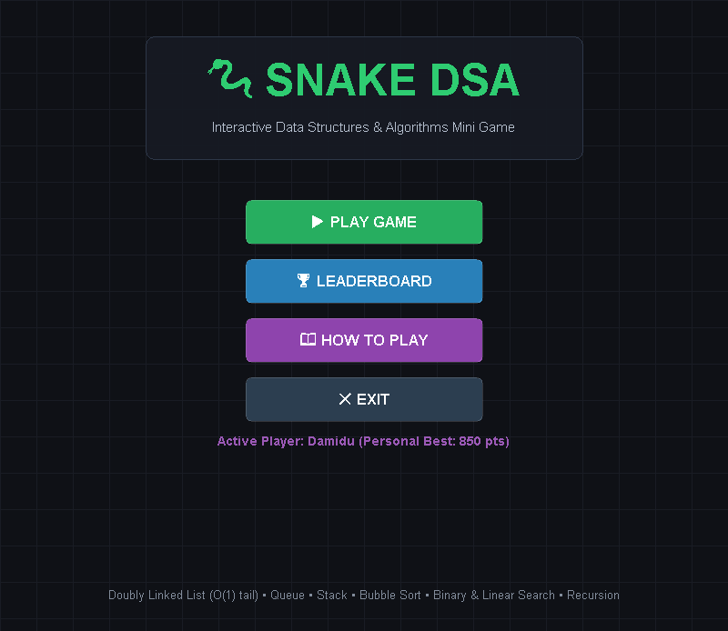
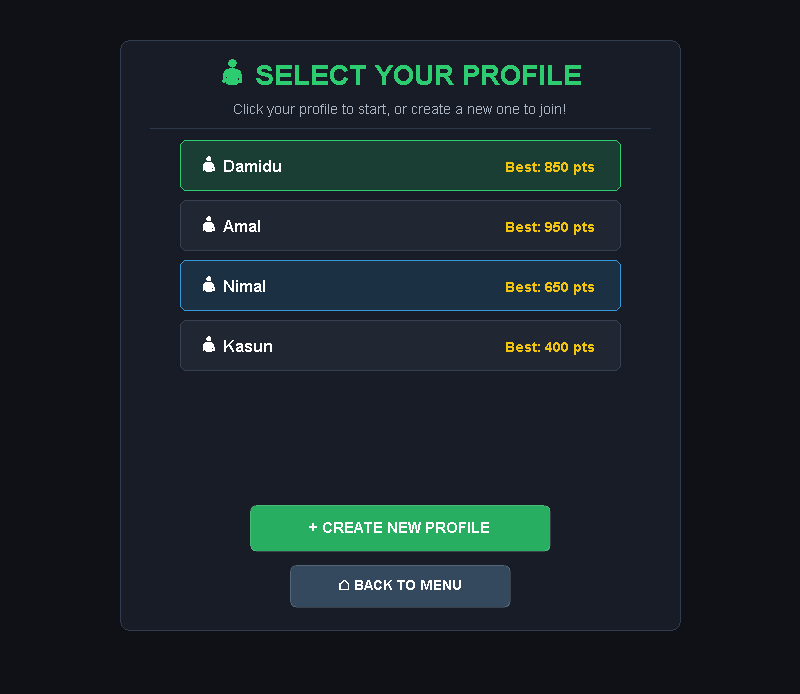
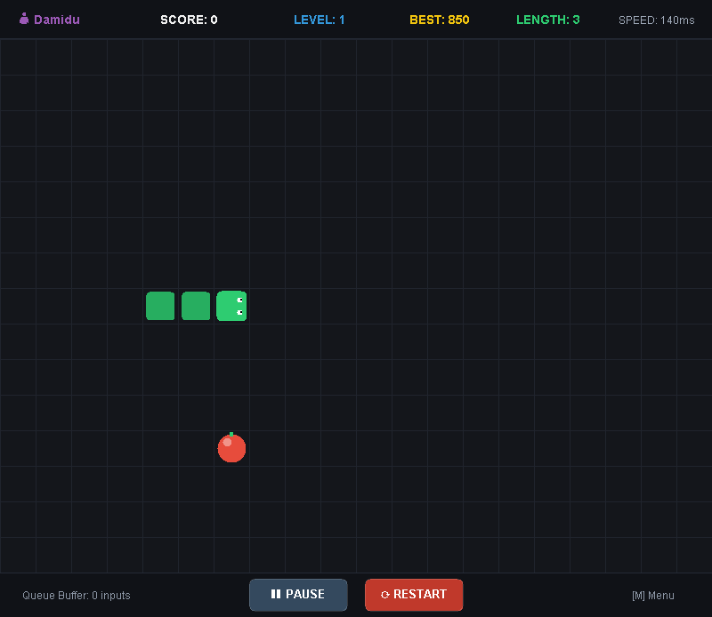
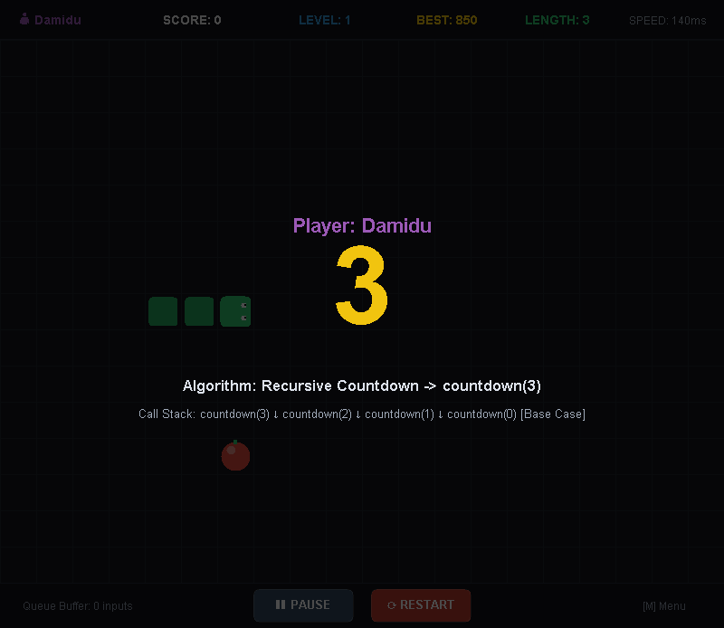
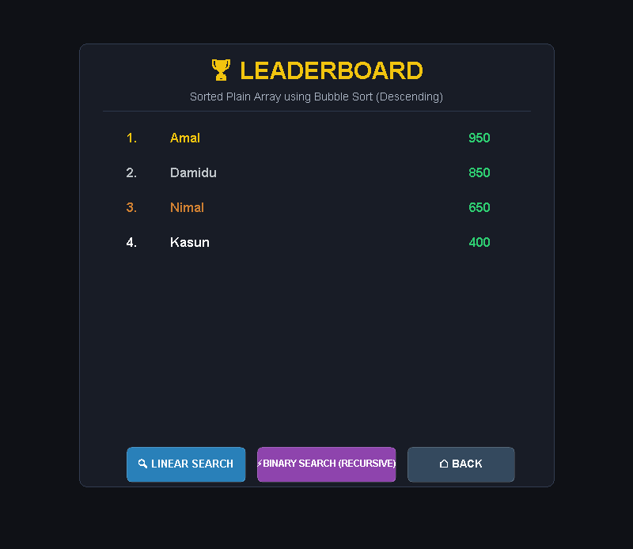
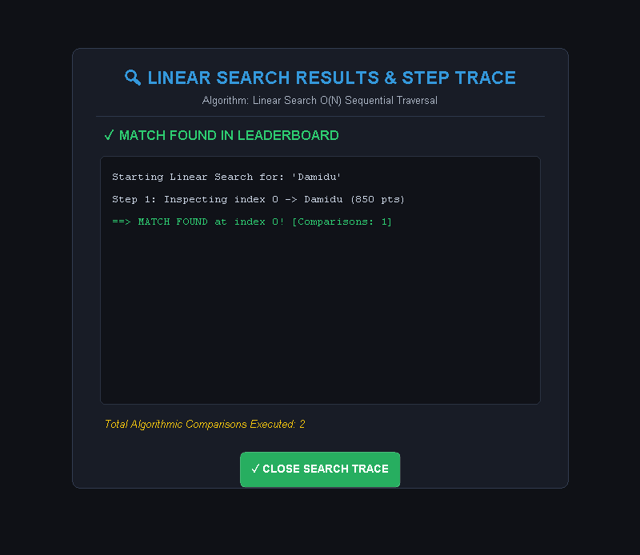
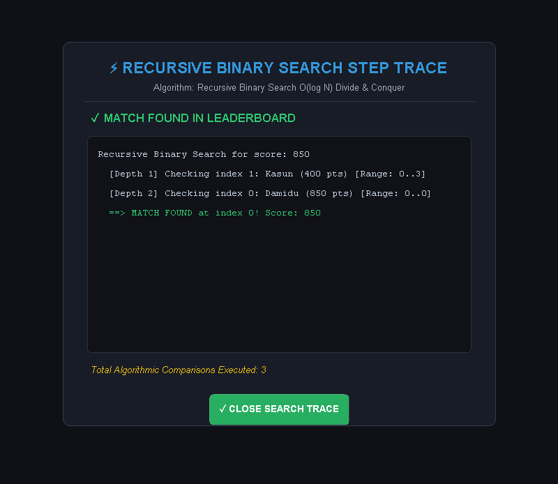
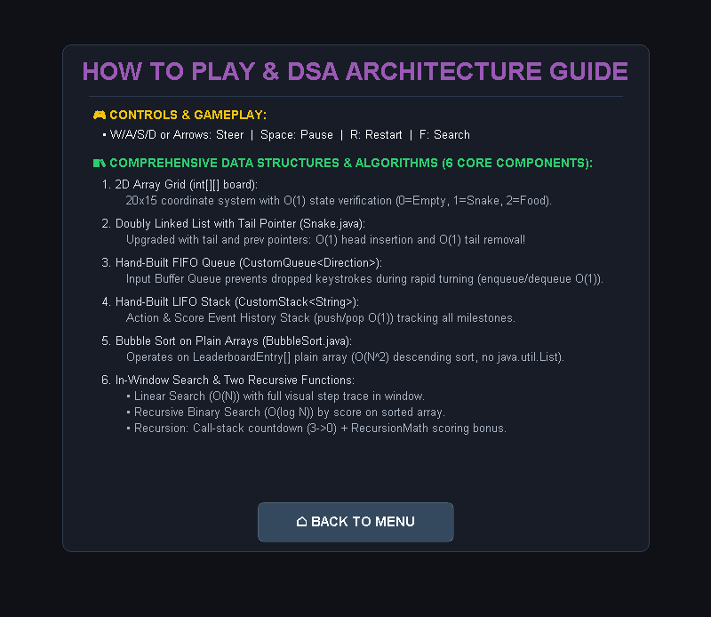
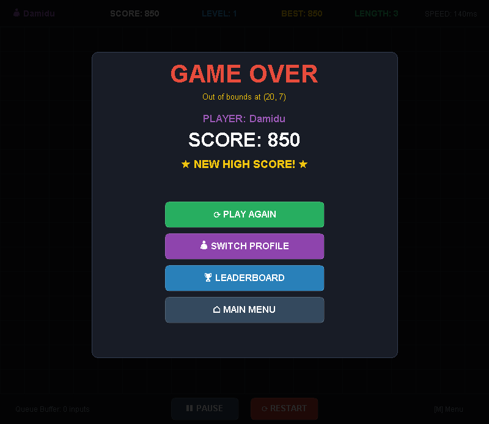
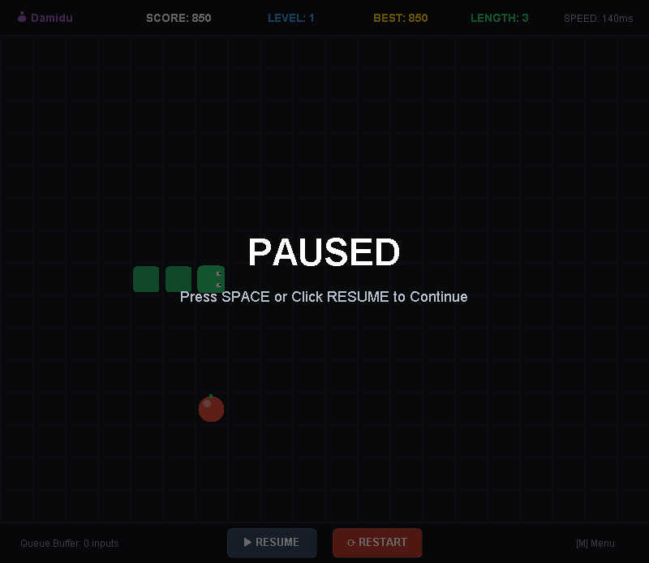

<div align="center">

# 🐍 Snake DSA Game

### Interactive Data Structures & Algorithms Mini Game

A fully-featured **Snake game** built in **Java Swing** that teaches and demonstrates core **Data Structures & Algorithms** concepts through an engaging, visual, and interactive gaming experience.

[](https://www.oracle.com/java/technologies/downloads/)
[](https://docs.oracle.com/javase/8/docs/technotes/guides/swing/)
[](https://netbeans.apache.org/)
[]()

</div>

---

## 📖 Table of Contents

- [✨ Features](#-features)
- [🧠 Data Structures & Algorithms](#-data-structures--algorithms)
- [📸 Screenshots](#-screenshots)
- [🎮 How to Play](#-how-to-play)
- [⬇️ How to Get the Game](#-how-to-get-the-game)
- [🚀 How to Run the Game](#-how-to-run-the-game)
- [💻 System Requirements](#-system-requirements)
- [📁 Project Structure](#-project-structure)
- [🎯 Demo DSA Features](#-demo-dsa-features)
- [📝 License](#-license)

---

## ✨ Features

| Feature | Description |
|---------|-------------|
| 🎮 **Classic Snake Gameplay** | Smooth grid-based movement with a 20×15 play area |
| 🧑‍🤝‍🧑 **Player Profiles** | Create and switch between multiple player profiles, each with their own personal best score |
| 🏆 **Live Leaderboard** | Top scores are tracked, sorted, and displayed with gold/silver/bronze medals |
| 🔍 **Visual Search Demo** | Execute **Linear Search** and **Recursive Binary Search** directly from the GUI with full step-by-step trace displays |
| 🔢 **Recursive Countdown** | The game starts with a genuine recursive call-stack countdown (3 → 2 → 1 → GO!) |
| ⚡ **Dynamic Difficulty** | The snake speeds up every 2 food items eaten, with level progression |
| ⏸️ **Pause & Restart** | Pause anytime with Space, or restart instantly |
| 🎯 **Smart Input Buffering** | Direction inputs are buffered in a custom FIFO queue so rapid key presses are never dropped |
| 📊 **Detailed HUD** | Score, level, personal best, snake length, current speed, and queue buffer status |
| 🎨 **Polished Dark UI** | Modern dark theme with hover effects, smooth animations, and emoji icons |

---

## 🧠 Data Structures & Algorithms

This game was built as an educational project to demonstrate **8 core Data Structures & Algorithms** concepts implemented **from scratch** (no `java.util` collections used for these structures):

### 1. 2D Array Grid — `int[][] board`
- **Purpose:** Game board representation with O(1) state lookups
- **Values:** `0` = Empty, `1` = Snake cell, `2` = Food
- **Complexity:** O(1) cell access

### 2. Doubly Linked List with Tail Pointer — `Snake.java`
- **Purpose:** Snake body representation with optimized O(1) tail removal
- **Implementation:** `Head ↔ Node ↔ Node ↔ Tail` with both `next` and `prev` pointers
- **Complexity:** Head insertion O(1), tail removal O(1), tail access O(1)

### 3. Custom FIFO Queue — `CustomQueue<T>`
- **Purpose:** Input buffering — stores up to 3 direction commands so rapid key presses aren't lost
- **Implementation:** Hand-built linked-node queue with `front` and `rear` pointers
- **Complexity:** `enqueue()` O(1), `dequeue()` O(1), `peek()` O(1)

### 4. Custom LIFO Stack — `CustomStack<T>`
- **Purpose:** Game event/score history tracking (food eaten, level ups, collisions)
- **Implementation:** Hand-built linked-node stack with `top` pointer
- **Complexity:** `push()` O(1), `pop()` O(1), `peek()` O(1)

### 5. Bubble Sort — `BubbleSort.java`
- **Purpose:** Sorts the leaderboard plain array in **descending** score order
- **Implementation:** Plain array + swap-based sorting with early-exit optimization
- **Complexity:** Best O(N), Average/Worst O(N²)

### 6. Linear Search — `LinearSearch.java`
- **Purpose:** Search leaderboard by player name with full visual step-by-step trace
- **Complexity:** Best O(1), Average/Worst O(N)

### 7. Recursive Binary Search — `BinarySearch.java`
- **Purpose:** Search leaderboard by target score using divide-and-conquer recursion
- **Requires:** Sorted descending array (Bubble Sort)
- **Complexity:** O(log N) with O(log N) call-stack space

### 8. Recursion — `RecursionCountdown.java` & `RecursionMath.java`
- **Countdown:** Genuine recursive call-stack `countdown(3) → countdown(2) → countdown(1) → countdown(0)` before each round
- **Math Bonus:** Recursive score calculation where longer snakes earn exponentially more bonus points per food

---

## 📸 Screenshots

<div align="center">

### 🏠 Main Menu


### 👤 Profile Selection


### 🎮 Gameplay


### ⏳ Recursive Countdown


### 🏆 Leaderboard


### 🔍 Linear Search Step Trace


### ⚡ Recursive Binary Search Step Trace


### 📖 How to Play & DSA Guide


### 💀 Game Over


### ⏸️ Pause Screen


</div>

---

## 🎮 How to Play

### 🕹️ Controls

| Key(s) | Action |
|--------|--------|
| <kbd>W</kbd> / <kbd>↑</kbd> | Move **Up** |
| <kbd>S</kbd> / <kbd>↓</kbd> | Move **Down** |
| <kbd>A</kbd> / <kbd>←</kbd> | Move **Left** |
| <kbd>D</kbd> / <kbd>→</kbd> | Move **Right** |
| <kbd>Space</kbd> / <kbd>P</kbd> | **Pause / Resume** |
| <kbd>R</kbd> | **Restart** round |
| <kbd>M</kbd> / <kbd>Esc</kbd> | Return to **Main Menu** |
| <kbd>C</kbd> / <kbd>N</kbd> | **Create** new profile |
| <kbd>F</kbd> | **Linear Search** (on leaderboard) |
| <kbd>B</kbd> | **Binary Search** (on leaderboard) |
| <kbd>Enter</kbd> | Confirm / Select |
| <kbd>1</kbd> – <kbd>9</kbd> | Quick-select profile by number |

### 🍎 Game Rules

1. **Objective:** Eat the apples to grow your snake and increase your score.
2. **Scoring:** Each apple earns points based on your snake's length (via recursive bonus calculation).
3. **Level Up:** Every 2 apples eaten, your level increases and the snake moves faster.
4. **Collision:** Hitting a wall or your own body ends the round.
5. **Win Condition:** Fill 100% of the board with your snake to achieve **Victory!**

---

## ⬇️ How to Get the Game

### Option 1: Clone with Git (Recommended)

```bash
git clone https://github.com/binusha12345/Snake_Game-dsa.git
cd Snake_Game-dsa
```

### Option 2: Download as ZIP

1. Go to the GitHub repository:  
   **https://github.com/binusha12345/Snake_Game-dsa**
2. Click the green **"Code"** button.
3. Click **"Download ZIP"**.
4. Extract the ZIP file to a folder of your choice.

### Option 3: Manual Copy

Copy the entire project folder (including `src/`, `nbproject/`, `build.xml`) to your computer.

---

## 🚀 How to Run the Game

### ✅ Prerequisites

You need **Java JDK 24 or newer** installed (the project is configured for Java 26 in NetBeans, and has been confirmed working on Java 24).

| Check | Command |
|-------|---------|
| **Verify Java is installed** | `java -version` |
| **Verify Java compiler** | `javac -version` |
| **Install Java (if missing)** | [Download from Oracle](https://www.oracle.com/java/technologies/downloads/) |

---

### 🖥️ Method 1: Run with NetBeans (Easiest)

1. Open **Apache NetBeans**.
2. Go to **File → Open Project**.
3. Select the `Snake_Game-dsa` folder (the one with `build.xml`).
4. Click **Open Project**.
5. Find the project **"DSA Assignment - Developing a Mini Game"** in the Projects panel.
6. Right-click the project → **Run** (or press <kbd>F6</kbd>).

> The game window will launch and you can start playing immediately!

---

### ⌨️ Method 2: Run from Command Line

#### On Windows (CMD / PowerShell)

```bash
cd path\to\Snake_Game-dsa

:: Compile all Java source files
javac -d out src\*.java

:: Run the game
java -cp out Main
```

#### On macOS / Linux

```bash
cd path/to/Snake_Game-dsa

# Compile all Java source files
javac -d out src/*.java

# Run the game
java -cp out Main
```

---

### 🛠️ Method 3: Run with Ant (NetBeans Build System)

If you have [Apache Ant](https://ant.apache.org/) installed:

```bash
cd path\to\Snake_Game-dsa

# Clean and build the project
ant clean jar

# Run the game
ant run
```

This will produce a JAR file at `dist/DSA__Assignment_-_Developing_a_Mini_Game.jar` which you can also run directly:

```bash
java -jar dist/DSA__Assignment_-_Developing_a_Mini_Game.jar
```

---

## 💻 System Requirements

### Minimum Requirements

| Component | Requirement |
|-----------|-------------|
| **OS** | Windows 10/11, macOS 11+, or any Linux distro with a graphical desktop |
| **Java** | JDK 24 or newer (JDK 26 recommended) |
| **RAM** | 512 MB (1 GB recommended) |
| **Storage** | ~50 MB free space |
| **Display** | 1024×768 resolution or higher (game window is **800×694 px**) |
| **Input** | Keyboard & Mouse |

### Recommended

| Component | Recommendation |
|-----------|----------------|
| **OS** | Windows 11 |
| **Java** | JDK 26 |
| **RAM** | 2 GB+ |
| **Display** | 1366×768 or higher |

> **Note:** The game is a lightweight Java Swing desktop app. It runs on any system that can run Java.

---

## 📁 Project Structure

```
Snake_Game-dsa/
│
├── build.xml                    # Apache Ant build configuration (NetBeans)
├── manifest.mf                  # JAR manifest file
├── nbproject/                   # NetBeans project configuration
│   ├── project.properties       # Build & run properties
│   └── project.xml              # Project metadata
│
├── src/                         # All Java source files
│   ├── Main.java                # 🚀 Entry point — launches the game window
│   ├── GamePanel.java           # 🎮 Main game panel: rendering, input, game loop, screens
│   ├── Snake.java               # 🐍 Doubly Linked List snake with O(1) tail removal
│   ├── SnakeNode.java           # Node class for the doubly linked list
│   ├── Food.java                # 🍎 Food placement & rendering (deterministic, no infinite loops)
│   ├── Profile.java             # 👤 Player profile management (high scores, games played)
│   ├── Leaderboard.java         # 🏆 Score tracking with bubble sort & search demos
│   ├── LeaderboardEntry.java    # Leaderboard entry model (name + score)
│   ├── CustomQueue.java         # 📥 Hand-built FIFO queue (input buffering)
│   ├── CustomStack.java         # 📤 Hand-built LIFO stack (event history)
│   ├── BubbleSort.java          # 🔃 Bubble Sort algorithm on plain arrays
│   ├── LinearSearch.java        # 🔍 Linear Search with step trace
│   ├── BinarySearch.java        # ⚡ Recursive Binary Search with step trace
│   ├── RecursionCountdown.java  # ⏳ Recursive call-stack countdown before game start
│   ├── RecursionMath.java       # ➗ Recursive scoring bonus calculation
│   └── dsa/                     # Alternate package entry (unused default template)
│
├── screenshots/                 # 📸 Game screenshots (used in this README)
└── out/                         # Compiled .class files (generated at build time)
```

---

## 🎯 Demo DSA Features

### Leaderboard Search (Try it in-game!)

1. From the **Main Menu**, click **🏆 LEADERBOARD**.
2. Click **🔍 LINEAR SEARCH** and enter a player name (e.g., `Damidu`).
3. The game displays the **full algorithm step trace** right in the window.
4. Click **⚡ BINARY SEARCH (RECURSIVE)** and enter a score (e.g., `850`) to see the recursive divide-and-conquer trace.

### Recursive Countdown

Every time a round starts, watch the countdown: **`3 → 2 → 1 → GO!`**.  
This is powered by a **genuine recursive call** that prints each call-stack frame to the console!

```
RECURSION CALL STACK INITIATED: countdown(3)
  [Stack Depth 1] countdown(3) -> Display: '3'
  [Stack Depth 2] countdown(2) -> Display: '2'
  [Stack Depth 3] countdown(1) -> Display: '1'
  [Stack Depth 4] countdown(0) -> BASE CASE REACHED! -> 'GO!' -> START GAME
```

---

## 📝 License

This project was created as a **Data Structures & Algorithms academic assignment** for educational purposes.  
Feel free to use, study, and learn from the code.

---

<div align="center">

**🐍 Made with ❤️ and Java Swing 🎮**

[⬆ Back to Top](#-snake-dsa-game)

</div>